# Robot OLP Studio – Digitaalisen Kaksosen Kattava Käyttöohje

Tämä opas esittelee **Robot OLP Studio (6-DOF Industrial Twin)** -ohjelmiston kaikki toiminnot, työtilat, työkalurivit, ohjauspaneelit sekä kalibrointidialogit. Ohjelmisto yhdistää teollisuusrobotiikan etäohjelmoinnin (Offline Programming, OLP), fysiikka- ja kinematiikkasimulaation sekä reaaliaikaisen laitteisto-ohjauksen (Bluetooth BLE & USB).

---

## Sisällysluettelo
1. [Järjestelmän arkkitehtuuri ja yleisnäkymä](#1-järjestelmän-arkkitehtuuri-ja-yleisnäkymä)
2. [Päätyötilat (Workspaces)](#2-päätyötilat-workspaces)
   - [Program (OLP) -työtila](#21-program-olp--etäohjelmointi)
   - [Simulation -työtila](#22-simulation--liikeratasimulaatio)
   - [Layout & Connections -työtila](#23-layout--connections--asettelu-ja-laitteisto)
3. [Yläpalkki (Ribbon Bar) & Turvatoiminnot](#3-yläpalkki-ribbon-bar--turvatoiminnot)
4. [3D-Simulaatiotila ja Katselutyökalut](#4-3d-simulaatiotila-ja-katselutyökalut)
5. [Yhteyspalkki (Connection Bar)](#5-yhteyspalkki-connection-bar)
6. [OLP Ohjelmointipaneeli (Statement Tree & Liikekäskyt)](#6-olp-ohjelmointipaneeli-statement-tree--liikekäskyt)
7. [Simulaation ohjauspaneeli & Laitteistolähetys](#7-simulaation-ohjauspaneeli--laitteistolähetys)
8. [Käsiajo (Jog Controls) & Nivelten säätö](#8-käsiajo-jog-controls--nivelten-säätö)
9. [Laitteiston kalibrointi & Nollapisteen trimmi (Calibration Dialog)](#9-laitteiston-kalibrointi--nollapisteen-trimmi)
10. [Työkalujen ja TCP:n määritys (Tool & End-Effector Setup)](#10-työkalujen-ja-tcpn-määritys)
11. [Työkappaleiden asemointi ja kiinnittimet (Workpiece Transform)](#11-työkappaleiden-asemointi-ja-kiinnittimet)

---

## 1. Järjestelmän arkkitehtuuri ja yleisnäkymä

Robot OLP Studio toimii siltana virtuaalisen 3D-mallin ja fyysisen 6-akselisen nivelvarsirobotin välillä. Se noudattaa modernin teollisuusautomaation standardeja:

- **Eteenpäin- ja käänteiskinematiikka (FK/IK)**: Robotin kärjen (TCP, Tool Center Point) laskenta $X, Y, Z$-koordinaatistossa sekä nivelkulmien $J_1 \dots J_6$ ratkaiseminen reaaliaikaisesti.
- **Törmäystarkastelu & Ulottuvuusanalyysi**: Työpöydän ja kappaleiden rajapintojen seuranta sekä robotin kinemaattisen työalueen (Reach Envelope) visualisointi.
- **Teollisuusrobotin koodivienti**: Liikeradat voidaan kääntää suoraan teollisuusrobottien ohjelmointikielille (**KUKA KRL**, **ABB RAPID**, **G-Code**).

---

## 2. Päätyötilat (Workspaces)

Käyttöliittymä jakautuu kolmeen optimoituun työtilaan, joita vaihdetaan yläreunan välilehdillä.

### 2.1 Program (OLP) – Etäohjelmointi

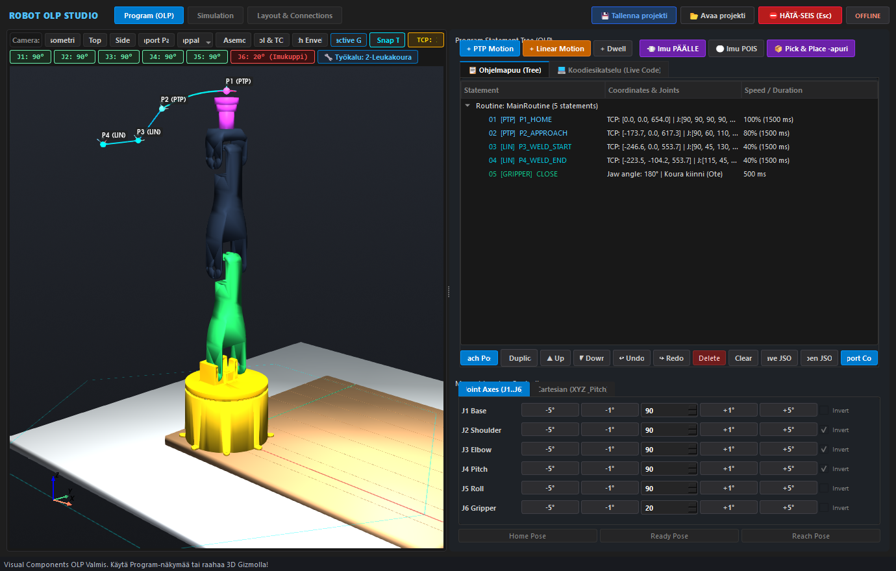

> [!NOTE]
> **Program (OLP)** on päänäkymä liikeratojen luomiseen ja muokkaamiseen. Vasemmalla on interaktiivinen 3D-työskentelyalue ja oikealla hierarkkinen lausekepuu (Statement Tree), pikapainikkeet liikekäskyille sekä kompakti karteesinen käsiajo.

**Tärkeimmät toiminnot tässä tilassa:**
- Pisteiden opettaminen suoraan 3D-näkymästä tai syöttämällä asteet/koordinaatit.
- Liiketyyppien valinta: `PTP` (Point-to-Point nivelajo), `LIN` (Lineaarinen suoraviiva-ajo) ja `Weave` (Hitsauspujotus).
- Kouran (Gripper) avaaminen ja sulkeminen sekä odotusviiveiden asetus.
- Koodin kääntäminen teollisuusrobottien syntaksiin (KUKA / ABB).

---

### 2.2 Simulation – Liikeratasimulaatio

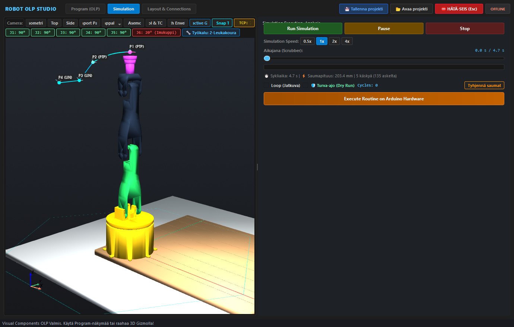

> [!TIP]
> **Simulation**-tilassa tarkistetaan ohjelmoitujen liikeratojen sujuvuus, singulaarisuudet, nopeusprofiilit ja mahdolliset törmäykset ennen ajoa fyysiselle robotille.

**Tärkeimmät toiminnot tässä tilassa:**
- Ohjelman toisto reaaliajassa, tauotus ja askellus eteen/taaksepäin.
- Aikajanalukija: liikeradan tarkastelu sekunti sekunnilta.
- Nopeusskaalaus ($10\% - 200\%$).
- **Reaaliaikainen suoratoisto (Stream to Physical Robot)**: mahdollistaa fyysisen robotin ajamisen täsmälleen virtuaalimallin tahtiin.

---

### 2.3 Layout & Connections – Asettelu ja laitteisto

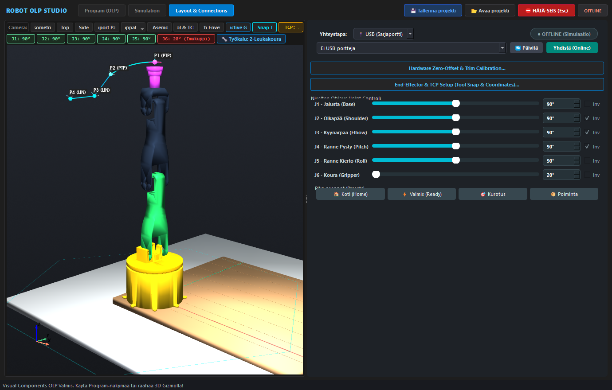

> [!IMPORTANT]
> Tässä tilassa hallitaan solun laitteistoyhteyksiä, suoritetaan servokohtainen manuaaliajo liukusäätimillä, määritetään pika-asennot (Home, Ready, Reach, Pick) sekä käännetään moottorien suunnat (`Inv`).

---

## 3. Yläpalkki (Ribbon Bar) & Turvatoiminnot

Yläpalkki on aina näkyvissä riippumatta aktiivisesta työtilasta. Se sisältää solun kriittiset ohjauspisteet:

| Elementti | Kuvaus / Toiminto | Pikanäppäin |
| :--- | :--- | :--- |
| **ROBOT OLP STUDIO** | Ohjelmiston nimilogo ja tilainfo. | - |
| **Program (OLP)** | Vaihtaa liikeratojen ohjelmointinäkymään. | `F1` |
| **Simulation** | Vaihtaa simulaatio- ja toistonäkymään. | `F2` |
| **Layout & Connections** | Vaihtaa asettelu-, yhteys- ja liukusäädinnäkymään. | `F3` |
| **💾 Tallenna projekti** | Tallentaa solun liikeradat, pisteet ja asetukset `.json`-projektitiedostoon. | `Ctrl + S` |
| **📂 Avaa projekti** | Avaa aiemmin tallennetun robottiohjelman. | `Ctrl + O` |
| **⛔ HÄTÄ-SEIS (Esc)** | **Kriittinen turvatoiminto**: Pysäyttää välittömästi simulaation ja katkaisee servojen liikkeen fyysisellä robotilla. | `Esc` |
| **Tilanäyttö (Oikea laita)** | Ilmoittaa yhteyden tilan vihreällä (`ONLINE (BLE: Arduino-Arm)`) tai harmaalla/punaisella (`OFFLINE`). | - |

---

## 4. 3D-Simulaatiotila ja Katselutyökalut

3D-näkymässä renderöidään robottisolu, nivelvarsi, työpöytä, kiinnittimet ja työstettävät kappaleet millintarkasti.

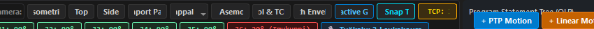

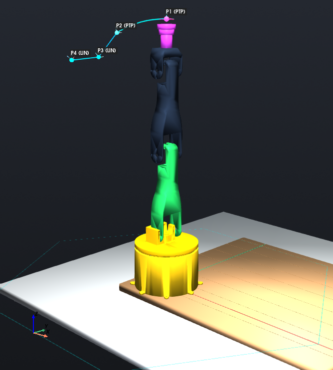

### 3D-työkalupalkin toiminnot vasemmalta oikealle:
1. **Camera: Isometric, Top, Side**:
   - `Isometric`: Asettaa viistokuvakulman yleisnäkymää varten.
   - `Top`: Vaihtaa kohtisuoraan ylänäkymään (helpottaa $X/Y$-linjausta).
   - `Side`: Vaihtaa sivuprofiiliin (helpottaa korkeuksien $Z$ arviointia).
2. **Import Part**:
   - Avaa tiedostoselaimen ulkoisten CAD-mallien (`.stl`, `.obj`, `.ply`) tuomiseksi työpöydälle.
3. **Kappaleet (Pikavalikko)**:
   - Lataa valmiita standardoituja esimerkkikappaleita: `Hitsauslevy (Weld Plate)`, `Laatikko (Box Fixture)`, tai `Putkiliitos (Pipe Joint)`.
4. **Asemoi...**:
   - Avaa työkappaleen siirto- ja kääntötyökalun ([Workpiece Transform Dialog](#11-työkappaleiden-asemointi-ja-kiinnittimet)).
5. **Tool & TCP...**:
   - Avaa työkalupään ja Tool Center Pointin hallinnan ([Tool Manager Dialog](#10-työkalujen-ja-tcpn-määritys)).
6. **Reach Envelope**:
   - Kytkee päälle/pois sinisen läpikuultavan puolipallon, joka kuvaa robotin maksimaalista kinemaattista ulottuvuutta ($R \approx 380\text{ mm}$).
7. **Interactive Gizmo**:
   - Aktivoi 3D-interaktiivisen ohjausankkurin suoraan kouran kärkeen. Raahaamalla nuolia robottia voidaan liikuttaa vapaasti tilassa käänteiskinematiikan (IK) ohjaamana.
8. **Snap TCP**:
   - Kohdistaa työkalun kärjen automaattisesti työkappaleen lähimpään särmään, kulmaan tai saumaan.
9. **Koordinaattinäyttö**:
   - Näyttää reaaliaikaisesti työkalun kärjen sijainnin: `TCP: X: ... | Y: ... | Z: ... mm` sekä nivelasteet $J_1 \dots J_6$.

---

## 5. Yhteyspalkki (Connection Bar)

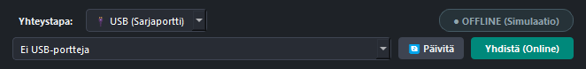

Yhteyspalkki vastaa tiedonsiirrosta fyysisen Arduino/ESP32-ohjainkortin ja PC-ohjelmiston välillä.

- **Yhteystapa**:
  - `Bluetooth (BLE)`: Langaton tiedonsiirto matalalla latenssilla.
  - `USB (Sarjaportti / COM)`: Perinteinen kaapeliyhteys (115200 baud).
- **Laitelistaus**: Näyttää löydetyt laitteet ja signaalinvoimakkuuden (esim. `Arduino-Arm [-45 dBm]`).
- **Etsi (BLE) / Etsi portit**: Skannaa lähialueen Bluetooth-laitteet tai kytketyt USB-sarjaportit.
- **Yhdistä / Katkaise yhteys**: Avaa tai sulkee kaksisuuntaisen sarjaliikenneyhteyden.
- **Pikalinkit**:
  - `Hardware Zero-Offset & Trim Calibration...`: Siirtyy suoraan servojen kalibrointiin.
  - `End-Effector & TCP Setup...`: Siirtyy työkalun säätöihin.

---

## 6. OLP Ohjelmointipaneeli (Statement Tree & Liikekäskyt)

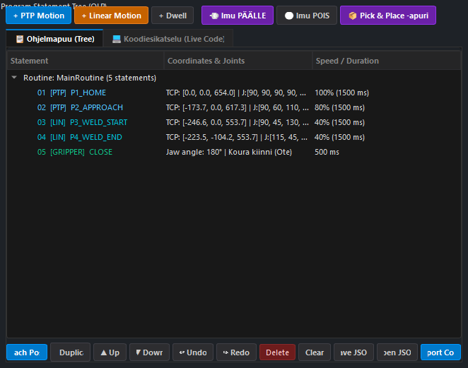

Tämä paneeli on etäohjelmoinnin ydin. Ohjelma rakennetaan loogisista lausekkeista, joita robotti suorittaa järjestyksessä.

### Liikekäskyjen lisäys:
- **`+ PTP (Nivelajo)`**:
  - Pisteestä toiseen siirtymä, jossa kaikki nivelet liikkuvat samanaikaisesti optimoiden liikeajan. Käytetään siirtymisessä ja lähestymisasennoissa.
- **`+ LIN (Lineaarinen liike)`**:
  - Kärki liikkuu suoraa viivaa pitkin karteesisessa avaruudessa. Välttämätön hitsaussaumoissa, liimauksessa ja koneistuksessa.
- **`+ Weave (Pujotus)`**:
  - Lineaarinen liike, johon yhdistetään sini- tai siksak-muotoinen poikittaisvärähtely (täyttöhitsaus).
- **`+ Koura (Gripper)`**:
  - Kouran asennon säätö ($0^\circ = \text{auki}, 180^\circ = \text{kiinni}$).
- **`+ Odotus (Wait)`**:
  - Asettaa aikaviiveen (esim. $1.5\text{ s}$ osan tarttumista varten).
- **`+ Nopeus (Speed)`**:
  - Muuttaa seuraavien liikkeiden maksiminopeutta ($1 - 100\%$).

### Ohjelmarakenteen hallinta:
- **`Opetus (Teach)`**: Päivittää valitun pisteen koordinaatit vastaamaan robotin nykyistä asentoa.
- **`Poista`**: Poistaa valitun käskyn puusta.
- **`Siirrä Ylös / Alas`**: Vaihtaa suoritusjärjestystä.
- **Koodivienti**:
  - `Vie KRL`: Tuottaa KUKA-yhteensopivan `.src`-tiedoston.
  - `Vie RAPID`: Tuottaa ABB-yhteensopivan `.mod`-tiedoston.
  - `Vie G-Code`: Tuottaa CNC/3D-tulostusstandardin mukaista G-koodia.

---

## 7. Simulaation ohjauspaneeli & Laitteistolähetys

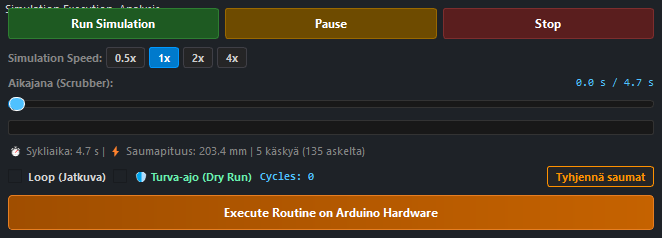

Simulaatiopaneeli mahdollistaa luodun OLP-ohjelman visuaalisen testauksen ja sen ajamisen fyysiselle robotille:

- **`▶ Toista (Play)`**: Käynnistää liikeratasimulaation alusta tai nykyisestä kohdasta.
- **`⏸ Tauko (Pause)`**: Pysäyttää simulaation tarkastelua varten.
- **`⏹ Pysäytä (Stop)`**: Resetoi simulaation alkuasentoon.
- **`⏮ / ⏭ Askel (Step)`**: Siirtää simulaatiota yhden käskyn tai aikayksikön kerrallaan.
- **`Toista jatkuvasti (Loop)`**: Ajaa ohjelmaa silmukassa (esim. messuesittelyt tai kestotestit).
- **Aikajana (Timeline Slider)**: Liukusäädin koko ohjelman aikajanan vapaaseen kelaamiseen.
- **Nopeuskerroin**: Simulaationopeus $0.1\times - 2.0\times$.
- **`⚡ Aja fyysistä robottia (Stream to Arm)`**:
  > [!CAUTION]
  > Kun tämä kytkin on aktiivinen ja laite on yhdistetty, PC lähettää jokaisella simulaatioaskeleella reaaliaikaiset servokulmat suoraan moottoreille. Varmista aina vapaa liikealue ennen käynnistystä!

---

## 8. Käsiajo (Jog Controls) & Nivelten säätö

Robot OLP Studiossa on kaksi käsiajotapaa: kompakti karteesinen ajo ja täysi nivelpaneeli.

### 8.1 Kompakti käsiajo (Compact Jog)
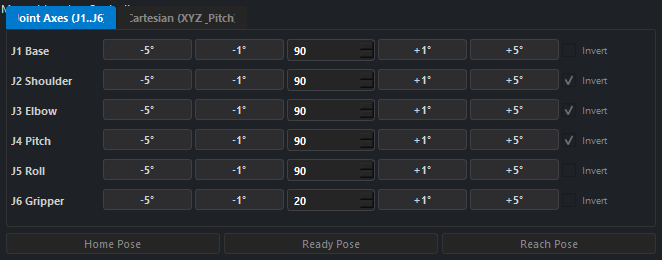

- **Karteesinen suuntaliike ($X, Y, Z$)**:
  - `X+ / X-`: Liikuttaa kärkeä eteen/taakse työpöydällä.
  - `Y+ / Y-`: Liikuttaa kärkeä vasemmalle/oikealle.
  - `Z+ / Z-`: Nostaa tai laskee kärkeä pystysuunnassa.
  - **Askelkoko**: Valittavissa `1 mm` (hienosäätö), `10 mm` (normaali) tai `50 mm` (nopea siirto).
- **Nivelkohtainen asteajo ($J_1 \dots J_6$)**:
  - Napeilla `+` ja `-` käännetään kutakin niveltä kerrallaan askelkoon ollessa `1°`, `5°` tai `15°`.
- **`Opetusasento (Teach Current)`**: Luo suoraan uuden käskyn nykyiseen asentoon.

### 8.2 Täysi nivelten säätöpaneeli (Joint Sliders)
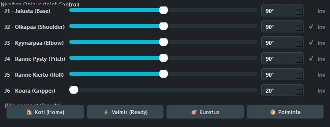

- **Liukusäätimet**:
  - `J1 - Jalusta (Base)`: Kääntö $0^\circ \dots 180^\circ$ vaakatasossa.
  - `J2 - Olkapää (Shoulder)`: Päävarsi eteen/taakse ($0^\circ \dots 180^\circ$).
  - `J3 - Kyynärpää (Elbow)`: Kyynärvarsi ylös/alas ($0^\circ \dots 180^\circ$).
  - `J4 - Ranne Pysty (Pitch)`: Työkalun kallistus ($0^\circ \dots 180^\circ$).
  - `J5 - Ranne Kierto (Roll)`: Työkalun aksiaalinen pyöritys ($0^\circ \dots 180^\circ$).
  - `J6 - Koura (Gripper)`: Tarttujan aukaisu ja puristus ($0^\circ \dots 180^\circ$).
- **`Inv` (Invert Servo Logic)**:
  - Kääntää ohjelmiston liikesuunnan päinvastaiseksi ($180^\circ - \text{arvo}$), jos fyysinen servomoottori on asennettu peilikuvana.
- **Pika-asennot (Quick Presets)**:
  - `Koti (Home)`: Perusasento $[90^\circ, 90^\circ, 90^\circ, 90^\circ, 90^\circ, 20^\circ]$.
  - `Valmis (Ready)`: Valmiusasento kappaleen yläpuolella.
  - `Kurotus (Reach)`: Vaakasuora kurotus eteenpäin.
  - `Poiminta (Pick)`: Pystysuora tartunta-asento pöytätasoon.

---

## 9. Laitteiston kalibrointi & Nollapisteen trimmi

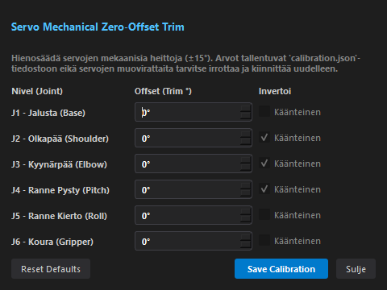

Kalibrointidialogi takaa, että digitaalisen kaksosen asennot vastaavat tarkasti fyysistä robottia:

1. **Trim Offset ($\pm 30^\circ$)**:
   - Kompensoi servon hammastuksen mahdollisen pienen asennusvirheen niin, että $90^\circ$ komento asettaa varren täsmälleen luotisuoraan kulmaan.
2. **Min / Max -rajat (Software Limits)**:
   - Rajoittaa servojen liikealuetta mekaanisten esteiden tai johtojen kiristymisen estämiseksi.
3. **Inversion Checkboxes**:
   - Pysyvä suunnanvaihto servotasolla.
4. **`Testaa asentoa`**:
   - Lähettää välittömästi testikulmat fyysisille servoille ilman ohjelman tallennusta.
5. **`Tallenna EEPROM / Profiili`**:
   - Tallentaa kalibrointiarvot `calibration.json`-tiedostoon ja ohjainkortin muistiin.

---

## 10. Työkalujen ja TCP:n määritys

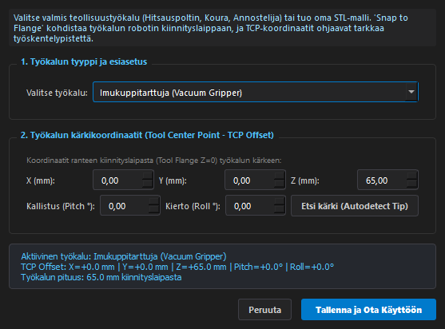

Robot OLP Studio tukee useita erilaisia työkalupäitä (End-Effectors):

- **Työkalutyypin valinta**:
  - `2-Leukakoura (Parallel Gripper)`: Standardi tarttuja kappaleiden siirtelyyn.
  - `Hitsauspoltin (Welding Torch)`: Polttimen suutin ja kaasuhylsy hitsausratojen suunnitteluun.
  - `Tyhjiötarrain (Suction Cup)`: Imukuppitarrain levyjen käsittelyyn.
  - `Kynä / Piirrin (Pen Plotter)`: Tarkkaan 2D-piirtämiseen ja kalibrointikokeisiin.
- **TCP Offset ($X, Y, Z$)**:
  - Siirtymä robotin viimeisen laipan keskipisteestä työkalun todelliseen toimintapisteeseen (esim. hitsauslangan kärki tai kouran tartuntakeskipiste).
- **Orientaatiokorjaus (Tool Angles)**:
  - Työkalun kallistus- ja kiertokulmat ranteeseen nähden.

---

## 11. Työkappaleiden asemointi ja kiinnittimet

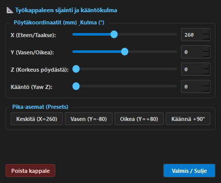

Tässä dialogissa asetetaan työpöydälle tuodut kappaleet oikeaan asentoon suhteessa robotin jalustaan:

- **Sijainti pöydällä ($X, Y, Z\text{ mm}$)**:
  - Siirtää kappaletta pöytätasolla. Positiivinen $X$ on eteenpäin, positiivinen $Y$ vasemmalle ja $Z$ pystysuoraan ylös.
- **Rotaatio ($Rot_Z$)**:
  - Pyörittää työkappaletta pystyakselinsa ympäri haluttuun kulmaan ($0^\circ \dots 360^\circ$).
- **`Snap to Table`**:
  - Laskee työkappaleen automaattisesti tarkasti pöydän pintaan ($Z = 0$), jolloin vältytään leijuvilta tai pöytään uppoavilta kappaleilta.
- **`Poista kappale`**:
  - Tyhjentää kiinnittimen solusta.

---

## Yhteenveto & Pikaopas uuden ohjelman luontiin

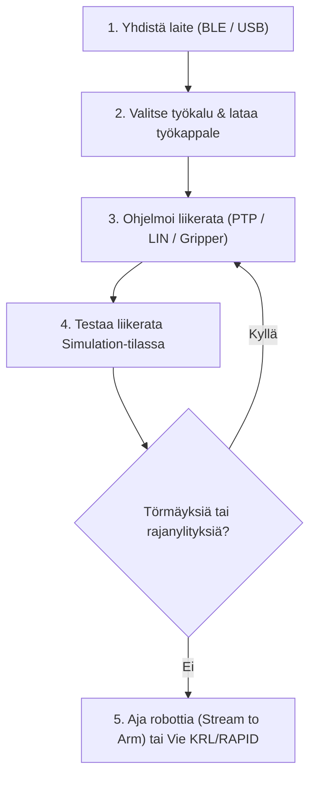

> [!TIP]
> **Käyttövinkki:** Aloita aina opettamalla `Home`-asento ensimmäiseksi pisteeksi, lähesty kappaletta `PTP`-liikkeellä ja suorita varsinainen työstö tai poiminta lineaarisella `LIN`-liikkeellä.
